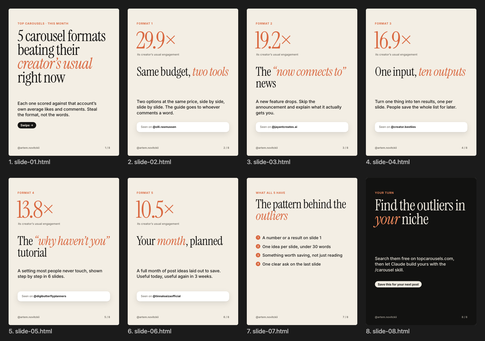

# /carousel: a Claude Code skill that makes your Instagram carousels

Type `/carousel 5 mistakes new runners make` and Claude hands back a finished carousel: the hook, every slide written, designed, rendered to 1080×1440 PNGs and checked. Free and open source.



How to use it and the full guide: **[novitckii.com/resources/carousel-skill](https://novitckii.com/resources/carousel-skill/)**

## What it does

1. **Finds proven references.** With [Top Carousels](https://topcarousels.com) connected, Claude searches carousels that beat their creator's usual engagement on your topic and studies their slides. Without it, paste a carousel you found there (free) or Claude uses the built-in formats.
2. **Plans it with you.** 3 hook options and a slide-by-slide outline. You pick, it writes.
3. **Builds every slide as layers.** Each slide is an HTML file where every element is its own layer, so "move the title up" or "make slide 4 dark" is a one-line change.
4. **Renders and checks.** PNGs plus a contact sheet that outlines in red anything that doesn't fit. Claude fixes it before you see it.

## Install

You need [Claude Code](https://claude.com/claude-code), Python 3 and Google Chrome (or Chromium or Edge). No API keys.

```bash
git clone https://github.com/artemnovitckii/claude-carousel-skill.git ~/claude-carousel-skill
cd ~/claude-carousel-skill && ./install.sh
```

Or as a plugin, inside Claude Code:

```
/plugin marketplace add artemnovitckii/claude-carousel-skill
/plugin install carousel-skill@claude-carousel-skill
```

Plugin skills are namespaced, so you'd type `/carousel-skill:carousel`. The git clone is the route I've tested.

## Make it better with Top Carousels

The skill works on its own, but it's much better when Claude can look at what's actually working. [Top Carousels](https://topcarousels.com) scores Instagram carousels against each creator's own average, so you see the ideas that worked, not just big accounts.

- **Free:** search outliers on topcarousels.com and paste the link or slide screenshots into Claude.
- **Connected (Pro, free trial):** Claude searches the library itself, reads every slide and can remix one for your niche:

```bash
claude mcp add --transport http topcarousels https://topcarousels.com/mcp
```

Then run `/mcp` in Claude Code to sign in.

## What's inside

```
skills/carousel/
  SKILL.md                 the workflow Claude follows
  assets/carousel.css      the design system: 3 themes, type scale, layer classes
  assets/check.js          flags anything that overflows (used by the contact sheet)
  assets/slide.html        a starting slide
  scripts/render.py        HTML → PNG + contact sheet, with headless Chrome
  references/              writing rules, design rules, how to use Top Carousels
examples/top-formats/      the example carousel above, as HTML
```

Made by [Artem Novitckii](https://novitckii.com). MIT licensed.
